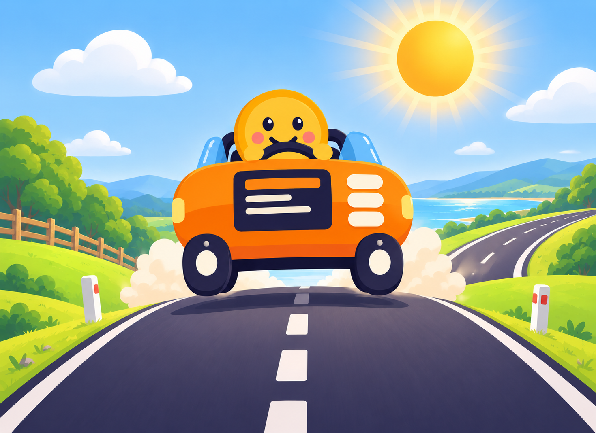

# The landing screen

How the first screen works, and the plan it was built from.

This is the sketch the screen was based on, not a picture of the result. The real screen is simpler and flatter, and the car is 3D.

## The idea

The headline says "Take self-custody for a test drive", so the screen shows one. A car that is a hardware wallet on wheels, driven by whoever you play as on the map, drives in from behind the hills and pulls up in front of the player.

1. An empty road on the island, the sea and the sun, for a moment.
2. The car jumps up from behind the front hill, nose up, wheels spinning.
3. It lands on the road facing the player, squashes, bounces back, and dust bursts out at the wheels.
4. The headline and the "Get started" button appear, either when the entrance ends or as soon as the player clicks or taps anywhere.
5. The car idles: wheels turning, body bobbing.
6. On "Get started" the car drives off toward the player and the next screen follows.

The whole entrance takes under two seconds. An earlier version had the car drive in along the distant road first; that was dropped because it was hard to make convincing.

## Style

- The scene fills the whole first screen.
- Soft, rounded shapes with gentle top-to-bottom gradients. No outlines.
- Bright and positive: a blue sky, a sun with rays, puffy clouds, the sea, lime-green hills with bushy trees, a fence and roadside posts.
- It is the map's island, so the two screens share a world. Home and the bank stand on the left of the road, a friend's place on the right, and the company's tower is on its own small island out in the bay. No mountains or mainland.
- The buildings are the map's own drawings, not copies: `SetupMap.landmark()` in `src/map.js` returns them and `src/ui.js` places them in the scene. The camera is up on a hill looking down, which is why buildings drawn from above fit. Keep every roof at or below the horizon, or that stops being true.
- Dark mode is the same scene at night: moon, stars, headlights on, the buildings dimmed.
- Bouncy motion. Everything overshoots and settles.
- The car faces the player. It is modelled on the orange SeedSigner case: a pill-shaped body with a dark screen and three stacked buttons, headlights at each end, wheels underneath. No logo or name. The driver sits behind it holding the steering wheel, with dust puffs at the wheels.
- The driver is the map's character (`SetupMap.driver()` in `src/map.js`): the same sticker head on the same clothes, Satoshi to begin with. Pick someone else on the map and they are driving when you come back.
- Simple and cartoony beats detailed. Where the reference is painterly, a cleaner shape is fine.
- The "Get started" button has a thick dark border and a hard drop shadow, and presses down when clicked.

## Rules

- Inline SVG, CSS and a little script only. No libraries, no image files, no network requests.
- The scenery is a painted drawing. Only the car is 3D: it is built from flat panels by `buildCar()` in `src/ui.js`, so it can turn with the road. Its jump is set by hand in the `sc-move`, `sc-pitch` and `sc-yaw` keyframes in `src/styles.css`.
- Reduced motion: the car is already parked and the text is already there.
- The player never has to wait. A click or tap skips to the end of the entrance. Keys don't.
- It must work on a phone held upright.

## Checklist

- [x] 1. Still frame: the scene and the car, in light and dark.
- [x] 2. Entrance: the jump over the front hill, the bounce, wheels spinning. Text appears at the end or on a click.
- [x] 3. Idle: the car bobs and sways, the driver glances about and waves now and then, the dust drifts away. Clouds drift, the sun's rays turn very slowly, the sea glints, sailboats and birds cross, trees and grass sway.
- [x] 4. Reactions: tap the car and it hops, then sets off, the same as "Get started". Hover "Get started" and it revs and the driver looks over.
- [x] 5. Exit: on "Get started" the car drives off toward the player, then the next screen opens.
- [x] 6. Fit: check on a real phone, in Safari and Firefox.

Not built: a small car on the distant road.

## Text

As little as possible: the headline with a pen-drawn double underline under "test drive", the privacy line and the button. Nothing on this screen refers to the player's real bitcoin.

## Notes over the scene

Once the car has landed, short notes appear over the scene one at a time, in turn, so the screen never fills up with labels.

- Pen arrows name what is there: "You", "Your home", "The bank", "A friend's place", "The exchange". They are the same orange stroke as the underline and draw themselves in. The list, with each one's position, is `NOTES` in `src/ui.js`. The map's introduction points at things with the same arrow: both are drawn by `penArrow()` and share one style rule.
- Then a speech bubble from the driver. It shows that character's `quote`, so it is always something the person really said. Never write a line for the bubble yourself.
- On a narrow window the buildings at the sides are out of view, so only "You" and the speech bubble are shown.
